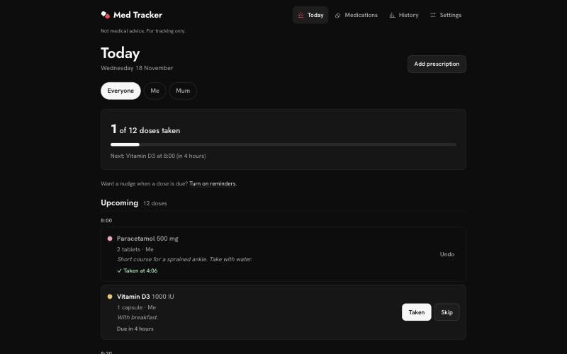

# Med Tracker

An installable, offline-first web app for scheduling medications, getting reminders and keeping track
of every dose, for yourself and the people you care for. There is no account and no server: all data
stays on your device.

A web rebuild of a React Native app I built in 2021.

**Live demo:** [med-tracker-aomar.web.app](https://med-tracker-aomar.web.app)
fills with a fictional household and a believable past week of doses.

> Not medical advice. For tracking only.

## Features

- **Today view.** Every dose due today, grouped by time into **Previous**, **Due now** and
  **Upcoming**. Each dose can be marked **Taken** or **Skip**, and undone. Doses more than an hour
  late are highlighted as overdue. A summary shows how many are taken and what is next. Previous
  starts folded when everything earlier in the day is logged, and opens by itself when a dose
  becomes overdue.
- **Several people.** Prescriptions belong to a person ("Me", "Mum"…), and Today and History can be
  filtered to one person or show everyone.
- **Prescriptions.** Medicine name, strength (such as 500 mg), form (tablet, capsule, liquid, drops,
  inhaler, injection), dose amount in the form's unit, one to six exact times a day, every day or
  chosen weekdays, a start date and an optional end date, notes and a color marker. Create, edit,
  archive and restore. Archived prescriptions keep their history but schedule nothing after the
  moment they were archived.
- **History.** Adherence over the last seven days, overall and per prescription, with an accessible
  SVG bar chart (values are printed on the bars and given to screen readers as text). An unlogged
  dose only counts against the score once it is overdue.
- **Reminders.** With permission, a notification for each time slot while the app is open, in a tab
  or installed. Logging a dose early cancels its reminder. Reminders are discreet ("8:00 AM · 2 doses
  due"): no medicine or person names, since they can show on a lock screen.
- **Installable and offline.** A web app manifest, generated icons (including a maskable one and a notification badge) and a
  service worker that precaches the whole app, so it opens with no connection. An **Install app**
  hint appears when the browser offers installation.
- **Backup.** Export everything as a JSON file and import it on this or another device. Imports are
  fully validated before anything is replaced.
- **Sample data and reset.** **Load sample data** on first run, and **Clear all data** in Settings.
- **Accessible and mobile first.** Semantic HTML, labelled native controls, a bottom tab bar on
  phones, visible focus, focus kept in place when a dose is logged, an error summary on the form, AA
  contrast, and motion only when the system allows it.

## Why it is technically interesting

### Private by design, with no backend at all

The data model lives in IndexedDB (through the small `idb` wrapper): stores for people,
prescriptions, dose logs and settings, with indexes used to delete a person together with their
prescriptions and logs in one transaction. Imports and "load sample data" swap the whole dataset in
a single transaction, so a failure leaves the old data intact. The app makes no network requests
for data; Firebase is used for static hosting only, with no SDK in the bundle.

Tabs stay in step through a `BroadcastChannel`: IndexedDB has no change events, so each write tells
other open tabs (or the installed app) to reload. Settings can ask the browser to mark storage as
persistent, since this device holds the only copy.

### Doses are generated, not stored

A prescription stores its schedule, not a list of future doses. `occurrencesForDay()` expands
schedules into the doses for any local day, and a dose log is keyed by
`prescriptionId@YYYY-MM-DDTHH:MM`, so each dose has at most one log and Taken, Skip and Undo are
single idempotent writes. History is computed from the same function.

### Local time done carefully

Days are local calendar keys (`YYYY-MM-DD`) built from the device's time zone, never from UTC ISO
strings, so "today" is the user's today. Day arithmetic moves calendar dates rather than adding 24
hours, which keeps daylight saving changes from skipping or repeating a day, and a dose time that
does not exist on the night clocks go forward resolves to the next real minute. Times are displayed
with `Intl` in the user's own 12 or 24 hour format.

### A hand-written service worker built from the real output

A small Vite plugin (`build/serviceWorkerPlugin.ts`) runs after the build, lists every file in
`dist`, and writes `dist/sw.js` from `service-worker/sw-template.js` with that list and a hash of
the file contents as the cache version. App routes go to the network first and fall back to the
precached shell when offline or after a three second timeout, so a new deploy shows on the next
visit. Every other file is served from the precache. The new `sw.js` installs in the background
and takes over once every tab of the old version is closed, so open pages keep the cached files they
were built with; then the old cache is removed.

### Reminders without a server, and their honest limits

`useReminders` schedules a `setTimeout` per upcoming time slot of today's unlogged doses. Timers are
rebuilt when doses change and when the app becomes visible again (browsers throttle timers in hidden
tabs), with a short catch-up window for doses that came due while hidden. Notifications go through
`ServiceWorkerRegistration.showNotification()`, because `new Notification()` throws on Android
Chrome. Reminders with the app fully closed would need Web Push, which needs a server; that is out of
scope for an app whose point is that nothing leaves the device.

## Stack

- Vite, React 19 and TypeScript (strict)
- IndexedDB through [`idb`](https://github.com/jakearchibald/idb)
- A hand-written service worker and web app manifest; icons drawn by a dependency-free script
  (`scripts/generate-icons.mjs`)
- No router or UI library: a small history-based router and hand-written CSS
- Firebase Hosting on the free Spark plan, for static files only

## Run locally

Requires Node 22.2 or newer.

```sh
npm install
npm run dev
```

The service worker is registered only in production builds. To try offline mode and installation
locally:

```sh
npm run build
npm run preview
```

Notifications, the service worker and installation need a secure context; `localhost` counts as one.

To redraw the icons after changing `scripts/generate-icons.mjs`, run `npm run icons`.

## Deploy (Firebase Hosting, free plan)

`firebase.json` deploys the `dist` folder to the hosting target `med-tracker`. App routes are
rewritten to `index.html`; hashed files in `/assets` get a one-year immutable cache, while
`index.html`, app routes, `sw.js` and the manifest stay on `no-cache`, so the next visit after a
deploy loads the new version. There are no Firestore rules or functions to deploy.

```sh
npm run build
firebase use --add                                    # pick your project
firebase hosting:sites:create your-site-id            # optional: a site of its own
firebase target:apply hosting med-tracker your-site-id
firebase deploy --only hosting:med-tracker
```

## Screenshots



## Project structure

```
build/             Vite plugin that writes the service worker
service-worker/    Service worker template
scripts/           Icon generator
public/            Manifest, favicon and generated icons
src/
  components/      One component per file
  hooks/           Data, time, reminders, install and storage hooks
  lib/             Domain logic: schedules, timing, adherence, backup, IndexedDB access
  pages/           Today, Medications, prescription editor, History, Settings
  styles/          Global CSS with design tokens
```

## Limitations

- History is computed from each prescription's current schedule, so editing times or days also
  changes how past days are scored.
- Reminders only fire while the app is open (see above).
- Data lives in one browser on one device; use Export and Import to move it.
